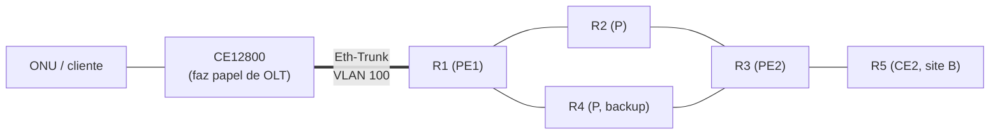

# Backbone Lab: estudo de redes de operadora (PE, P, CE e OLT)

Projeto de estudo para entender, na prática, como funciona o backbone de um
provedor: camadas, protocolos, redundância e serviços. O laboratório é montado
no **PNETLab** com equipamentos Huawei (NE40E e CloudEngine 12800).

> Este repositório é material de estudo. **Não coloque configurações reais de
> produção aqui** (senhas, hashes, comunidades SNMP, IPs públicos, nomes de
> clientes). Anonimize antes.

## Topologia alvo

## Como estudar

1. Leia `docs/01-camadas.md` para o mapa geral.
2. Siga os labs na ordem de `docs/00-roadmap.md`.
3. Em cada lab: leia o README, digite as configs, rode as verificações.
4. Depois de funcionar, quebre de propósito (pasta `troubleshooting/`).

## Conteúdo

| Pasta | O que tem |
|---|---|
| `docs/` | Conceitos e comandos (índice abaixo) |
| `diagrams/` | Topologias em Mermaid (o GitHub renderiza) |
| `labs/` | Um diretório por lab: objetivo e o porquê de cada passo |
| `exercicios/` | 98 questões com gabarito, por tema |
| `troubleshooting/` | Cenários de erro para diagnosticar |

## Progresso

Veja o checklist em `docs/00-roadmap.md`.

## Índice dos guias (`docs/`)

| Arquivo | Assunto |
|---|---|
| 01-camadas | Mapa das camadas e ordem de montagem |
| 02-l2-vs-l3-backbone | Link L3 roteado x L2 (Vlanif) |
| 03-redundancia | Redundância por camada, loop e STP |
| 04-mpls-e-servicos | Visão geral de MPLS, TE e serviços |
| 05-l2vpn-vs-l3vpn | Diferença e fluxo de pacote |
| 06-glossario | Termos |
| 07-plano-de-enderecamento | IPs do lab |
| 08-eth-trunk-lacp | Agregação de links |
| 09-vlan-trunk-access-vlanif | VLAN, trunk, access, Vlanif, QinQ |
| 10-ospf | OSPF, BFD, ldp-sync, FRR |
| 11-mpls-ldp | MPLS, LDP e LDP remoto |
| 12-mpls-te-tunnel | Túneis TE, backup, tunnel-policy |
| 13-vsi-vpls-pseudowire | VSI, VPLS e pseudowire |
| 14-mascaras-e-ips | Qual máscara e IP usar |
| 15-mapa-do-analista-de-rede | Checklist de estudo e lacunas |
| 16-portas-e-protocolos | Portas, números e preferências |

> Os comandos dos guias 10 a 13 vêm da sintaxe de uma rede real e foram adaptados
> aos IPs do lab. Eles **ainda não foram testados** no PNETLab: ao montar cada
> lab, confirme com `?` e anote os ajustes.
