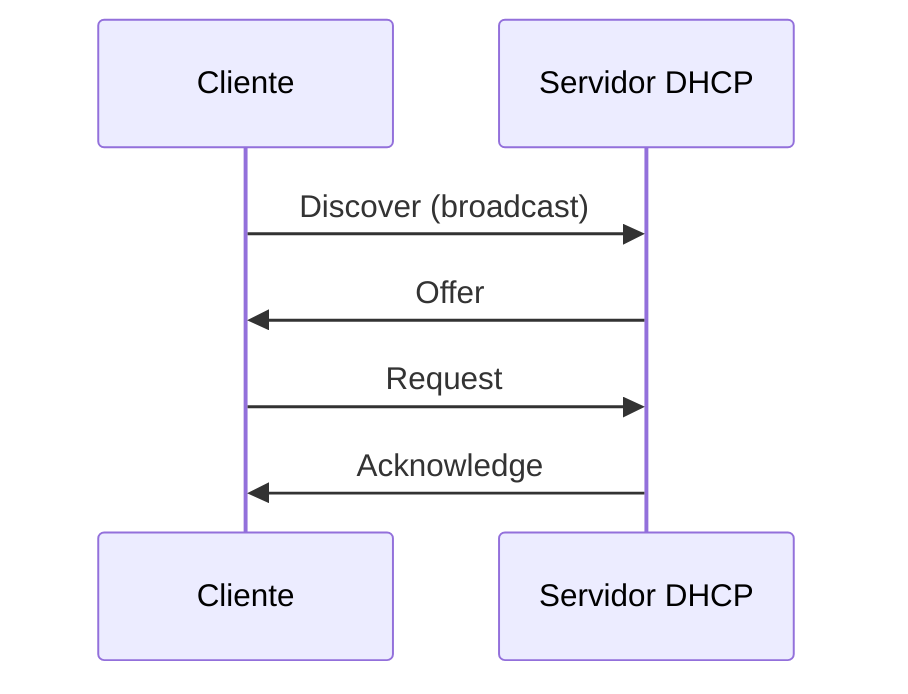

## O que é
Atribui automaticamente **IP, máscara, gateway e DNS** aos clientes, com um tempo de concessão (**lease**).

## Processo DORA (UDP 67 servidor, 68 cliente)

## Renovação do lease
- **T1** (50% do tempo): o cliente tenta renovar com o mesmo servidor.
- **T2** (87,5%): se não conseguiu, tenta qualquer servidor.
- Ao expirar, o cliente perde o endereço.

## DHCP Relay
O Discover é broadcast e **não atravessa roteadores**. O **relay** (no gateway) converte o broadcast em unicast para o servidor, preenchendo o campo *giaddr* com o IP da interface de origem, o que permite ao servidor escolher o **pool** correto.

## Em redes de provedor
- **IPoE**: autenticação do cliente por DHCP, sem PPPoE.
- **Option 82** (agente de relay): o equipamento de acesso insere **circuit-id** e **remote-id** (por exemplo, a porta da OLT), identificando de onde veio o pedido.
- O tráfego DHCP costuma ter **VLAN própria** e viajar por L2VPN até o servidor.

## Segurança
**DHCP snooping** marca portas confiáveis (onde está o servidor) e bloqueia respostas DHCP vindas de portas de cliente, evitando servidores falsos.

## Erros comuns
Falta de relay, servidor sem pool para a rede do relay, VLAN do DHCP não liberada no trunk, servidor falso na rede.

## O que costuma cair na prova

- Ordem DORA e portas UDP 67/68
- Função do relay e do campo giaddr
- T1 e T2 da renovação
- DHCP snooping e option 82
