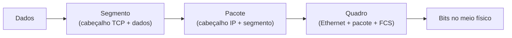

## Por que estudar
Todo diagnóstico começa por descobrir **em que camada** está o problema. O modelo OSI é a linguagem comum de provas, chamados e conversas entre equipes.

## As 7 camadas do OSI

| Camada | Nome | Unidade de dados (PDU) | Exemplos | Equipamento típico |
|---|---|---|---|---|
| 7 | Aplicação | Dados | HTTP, DNS, DHCP, SSH, SNMP | |
| 6 | Apresentação | Dados | TLS (criptografia), codificações | |
| 5 | Sessão | Dados | Controle de sessões | |
| 4 | Transporte | Segmento (TCP) ou datagrama (UDP) | TCP, UDP, portas | Firewall com estado |
| 3 | Rede | Pacote | IP, ICMP, OSPF, roteamento | Roteador, switch L3 |
| 2 | Enlace | Quadro (frame) | Ethernet, VLAN, STP, LACP | Switch, placa de rede |
| 1 | Física | Bits | Cabo, fibra, conector, sinal | Transceiver, cabo, hub |

O ARP costuma ser colocado entre a camada 2 e a 3, porque liga um endereço IP a um endereço MAC.

## O modelo TCP/IP (4 camadas)

| TCP/IP | Corresponde no OSI |
|---|---|
| Aplicação | 5, 6 e 7 |
| Transporte | 4 |
| Internet | 3 |
| Acesso à rede | 1 e 2 |

## Encapsulamento

Ao descer pelas camadas, cada uma **acrescenta seu cabeçalho** aos dados da camada de cima. No destino acontece o inverso.

Cada equipamento olha só até a sua camada: o switch lê o cabeçalho Ethernet, o roteador lê o IP, e só o destino chega aos dados.

## Diagnóstico por camada

| Sintoma | Camada sob suspeita | O que verificar |
|---|---|---|
| Porta sem luz, link down | 1 | Cabo, transceiver, potência óptica, porta desligada |
| Link up mas sem comunicação local | 2 | VLAN, trunk, MAC, STP, agregação |
| Mesma rede funciona, outra rede não | 3 | Máscara, gateway, rotas, ida e volta |
| Ping funciona, o serviço não | 4 a 7 | Porta bloqueada, ACL, firewall, aplicação |

A regra prática é investigar **de baixo para cima**: não adianta analisar rota se o cabo está solto.

## O que costuma cair na prova

- PDU de cada camada: dado, segmento, pacote, quadro e bits
- Em que camada atuam switch, roteador e firewall
- Camada de cada protocolo (ARP, IP, TCP, DNS, STP)
- Diferença entre OSI (7 camadas) e TCP/IP (4 camadas)
