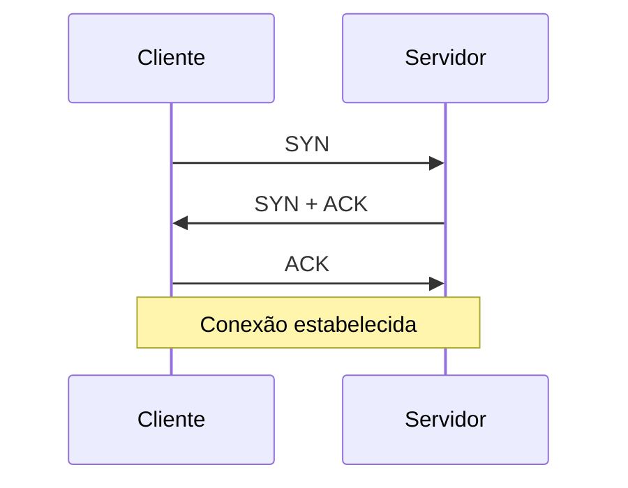

## Camada de transporte
Leva os dados entre **aplicações**, usando **portas** para saber a qual programa entregar.

## TCP x UDP

| | TCP | UDP |
|---|---|---|
| Conexão | Orientado a conexão | Sem conexão |
| Confiabilidade | Confirmação, retransmissão, ordenação | Nenhuma |
| Controle de fluxo e congestionamento | Sim (janela) | Não |
| Custo | Maior | Baixo |
| Usos | Web, SSH, BGP, e-mail | DNS, DHCP, SNMP, syslog, NTP, voz e vídeo |

## Handshake de 3 vias (TCP)

O encerramento usa **FIN** (ou **RST** para abortar). Flags importantes: SYN, ACK, FIN, RST, PSH.

## Faixas de portas
| Faixa | Nome |
|---|---|
| 0 a 1023 | Bem conhecidas (well-known) |
| 1024 a 49151 | Registradas |
| 49152 a 65535 | Dinâmicas (origem do cliente) |

Uma conexão é identificada por **IP de origem, porta de origem, IP de destino, porta de destino e protocolo**.

## MTU e MSS
A **MTU** é o maior quadro de camada 3 do enlace (1500 em Ethernet comum). O **MSS** é o maior bloco de dados do TCP, normalmente MTU menos 40 bytes de cabeçalhos IP e TCP. Em PPPoE (MTU 1492) o MSS costuma ser ajustado para evitar fragmentação.

## Portas para decorar
Consulte a tabela completa em [Portas e protocolos](#/conceitos/10-referencias/portas-e-protocolos).

## Erros comuns
Firewall permitindo a porta de ida mas não a volta, confundir porta de origem com porta de destino em ACL, MTU/MSS inadequados causando sites que "travam".

## O que costuma cair na prova

- Diferenças entre TCP e UDP e exemplos de uso
- Handshake de três vias e flags
- Faixas de portas
- TCP 179 (BGP), TCP 22, UDP 53, UDP 161
