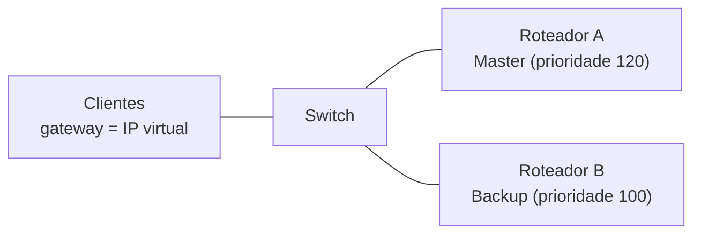

## O problema
Os clientes têm **um gateway** configurado. Se esse roteador cair, todos perdem a saída. O VRRP cria um **gateway virtual** servido por mais de um roteador.

## Como funciona
- Os roteadores formam um **grupo VRRP** (VRID) com um **IP virtual** e um **MAC virtual**.
- O de maior **prioridade** (padrão 100) é o **Master** e responde pelo IP virtual.
- Os demais são **Backup**. Se o Master para de enviar anúncios, o de maior prioridade assume.
- Os clientes apontam para o **IP virtual** e não percebem a troca.

## Detalhes importantes
| Item | Valor |
|---|---|
| Protocolo | IP número 112 |
| Multicast dos anúncios | 224.0.0.18 |
| Intervalo de anúncio | 1 segundo (padrão) |
| MAC virtual (VRRPv2) | 00-00-5E-00-01-VRID |
| **Preempção** | O de maior prioridade retoma o papel de Master quando volta |

O tempo de falha depende do intervalo; o **BFD** pode acelerar a detecção.

## Comparação
O **HSRP** (Cisco) e o **GLBP** têm função parecida; o VRRP é padrão aberto.

## Erros comuns
Prioridades iguais (decide pelo maior IP), preempção desligada sem querer, VLAN de anúncios não liberada entre os roteadores, IP virtual igual ao IP real de um dos roteadores sem planejamento.

## O que costuma cair na prova

- Master e Backup, prioridade e preempção
- IP virtual e MAC virtual
- Protocolo IP 112 e multicast 224.0.0.18
- VRRP x HSRP
