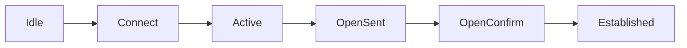

## O que é
Protocolo de roteamento **entre sistemas autônomos** (AS). É o que sustenta a internet e, dentro da operadora, carrega rotas de serviços (como VPNs). Usa **TCP porta 179** e é do tipo **vetor de caminho**.

## Conceitos
| Termo | Significado |
|---|---|
| **AS** | Conjunto de redes sob a mesma administração, com um número (ASN) |
| ASN de 16 e 32 bits | Privados: 64512 a 65534 e 4200000000 a 4294967294 |
| **eBGP** | Sessão entre ASs diferentes |
| **iBGP** | Sessão dentro do mesmo AS |

## Sessão: estados

Só em **Established** as rotas são trocadas. Mensagens: Open, Update, Keepalive (60 s) e Notification; o hold time padrão é 180 s.

## Atributos principais
| Atributo | Função |
|---|---|
| **AS-Path** | ASs percorridos; evita loop (rota com o próprio AS é descartada) e preferência por caminho curto |
| **Next-Hop** | Para onde enviar o tráfego |
| **Local Preference** | Preferência **dentro** do AS (maior vence) |
| **MED** | Sugere ao vizinho a entrada preferida (menor vence) |
| **Origin** | Como a rota foi originada |
| **Community** | Marcação para aplicar políticas |

## Decisão (ordem usual)
1. Maior Local Preference
2. Menor AS-Path
3. Menor Origin
4. Menor MED
5. eBGP preferido ao iBGP
6. Menor métrica do IGP até o next-hop
7. Desempates (router-id)

A Huawei avalia primeiro um valor proprietário (PrefVal), como a Cisco faz com o *weight*.

## Regras do iBGP
- Uma rota aprendida de um peer iBGP **não é repassada** a outro peer iBGP. Por isso exige **malha completa**, **route reflector** ou **confederação**.
- O **next-hop** não muda dentro do AS: costuma-se usar `next-hop-self` ou garantir que o IGP alcance o next-hop.
- As sessões iBGP devem sair pelas **Loopbacks**.

## Famílias de endereços
`ipv4 unicast`, `ipv6 unicast`, **`vpnv4`** (L3VPN), **`l2vpn`**. É o MP-BGP: o mesmo protocolo, vários tipos de rota.

## Uso em provedor
Trânsito e peering com outros ASs, anúncio dos blocos próprios, **anycast de DNS**, rotas de L3VPN entre PEs, controle por **prefix-list** e **route-policy**.

## Verificação
```
display bgp peer
display bgp routing-table
```

## Erros comuns
Sessão presa em Active (porta 179 bloqueada, IP/AS errado), next-hop inalcançável, regra do iBGP esquecida, ausência de filtros de entrada e saída.

## O que costuma cair na prova

- Estados da sessão e porta TCP 179
- eBGP x iBGP e a regra de não repassar entre peers iBGP
- Ordem dos atributos de decisão
- AS-Path como proteção contra loop
