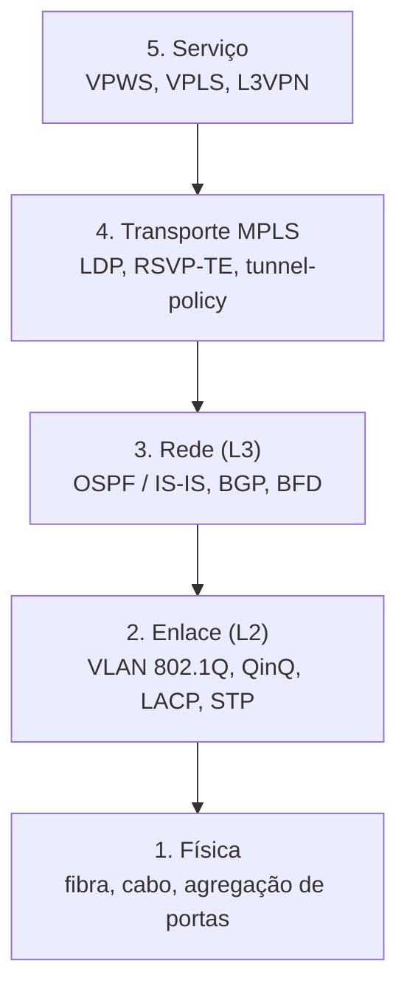

Cada camada resolve um problema e usa a anterior. Monta-se de baixo para cima.

| Camada | Pergunta que responde | Recursos |
|---|---|---|
| 1. Física | Como os equipamentos se ligam? | Fibra, cabo, DWDM |
| 2. Enlace | Como os quadros trafegam em cada link? | VLAN, QinQ, LACP, STP |
| 3. Rede | Como os roteadores se enxergam? | OSPF, IS-IS, BGP, BFD |
| 4. MPLS | Como levar o tráfego com caminho controlado? | LDP, RSVP-TE, FRR |
| 5. Serviço | O que o cliente recebe? | Pseudowire, VPLS, L3VPN |

## Ordem de montagem

1. Plano de endereçamento (links /30, Loopbacks /32, gerência separada)
2. Ligar e agregar os links (Eth-Trunk)
3. IPs de link, Loopback e gerência
4. IGP (OSPF) anunciando Loopbacks e links
5. BFD e `ldp-sync` para convergência rápida
6. MPLS e LDP nos links do backbone
7. Túneis TE com caminho principal e backup
8. LDP remoto entre os PEs
9. Serviços (pseudowire, VPLS, L3VPN)
10. Acesso (OLT e VLANs)
11. Segurança e monitoramento

## Papéis dos equipamentos

| Papel | Função | No lab |
|---|---|---|
| CE | Equipamento do cliente (ou OLT na ponta) | CE12800, R5 |
| PE | Borda da operadora: põe e tira labels, entrega o serviço | R1, R3 |
| P | Miolo: só troca labels, não conhece clientes | R2, R4 |

## O que costuma cair na prova

- Ordem de montagem de uma rede de operadora
- Papéis CE, PE e P
- Cada camada usa a anterior
