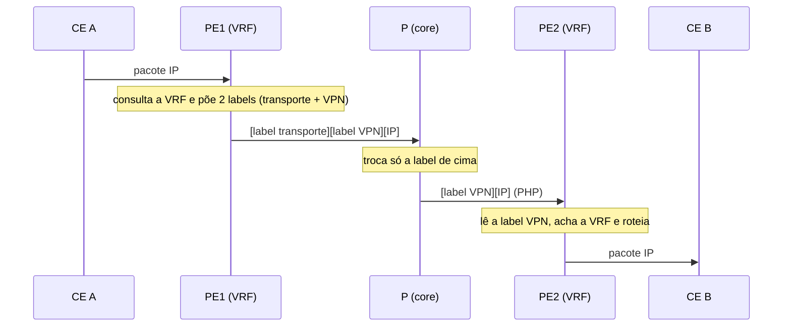

## O que é
A operadora entrega ao cliente uma **rede IP privada** entre os sites dele. Os **PEs roteiam** o tráfego do cliente, mantendo cada cliente isolado dos demais.

## Os componentes
| Elemento | Função |
|---|---|
| **VRF** (`ip vpn-instance`) | Tabela de rotas **privada** de cada cliente |
| **RD** | Prefixo que torna a rota do cliente **única** no BGP (clientes diferentes podem usar o mesmo IP) |
| **RT** (export/import) | Etiqueta que decide **quem importa as rotas de quem** |
| **MP-BGP VPNv4** | Carrega as rotas dos clientes entre os PEs |
| **Label de serviço** | Identifica a VRF no PE de saída |

## Caminho de um pacote



## Como a rota chega ao outro PE
1. O CE anuncia sua rede ao PE (rota estática, OSPF ou eBGP) **dentro da VRF**.
2. O PE exporta a rota no BGP VPNv4 com **RD**, **RT** e a **label VPN**.
3. O PE remoto importa apenas as rotas cujo **RT casa** com a sua VRF.

## Configuração em linhas gerais
```
ip vpn-instance CLIENTE_A
 ipv4-family
  route-distinguisher 65000:1
  vpn-target 65000:1 both
interface Vlanif200
 ip binding vpn-instance CLIENTE_A
 ip address 10.1.0.1 255.255.255.252
```
**Ordem importa:** o `ip binding vpn-instance` **apaga o IP** da interface; o IP vem depois.

## Verificação
```
display ip vpn-instance
display ip routing-table vpn-instance CLIENTE_A
display bgp vpnv4 all peer
```

## Topologias
Malha completa (todos se enxergam) ou **hub-and-spoke** (os sites só falam via a matriz), controlada pelos RTs.

## Erros comuns
IP apagado após o binding, RTs de export e import que não casam, RD repetido entre clientes, sessão VPNv4 não ativada, rotas do cliente não redistribuídas no BGP da VRF.

## O que costuma cair na prova

- RD x RT e para que serve cada um
- Pilha de duas labels e o papel do P
- PE-CE: protocolos possíveis
- Erro clássico do ip binding
