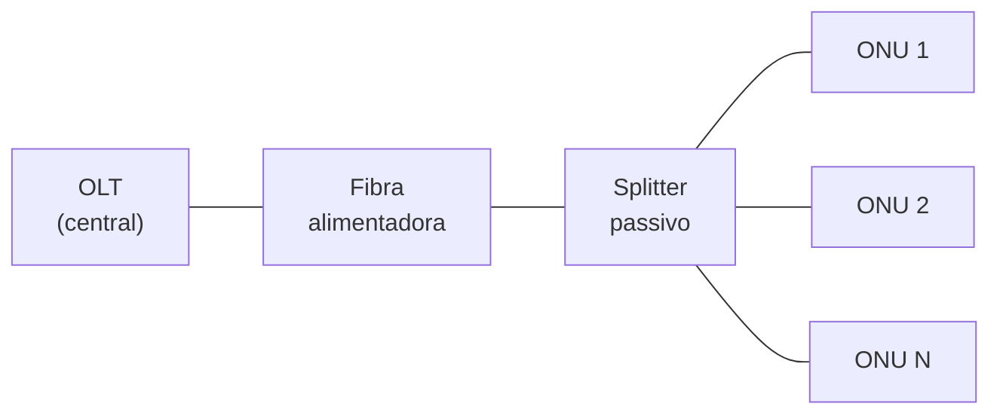

## O que é
**PON** (Passive Optical Network) é uma rede óptica **ponto-multiponto sem elementos ativos** entre a central e o cliente. Uma fibra sai da **OLT**, passa por **divisores (splitters) passivos** e atende várias **ONUs/ONTs**.

A infraestrutura de fibra, caixas e divisores é a **ODN** (Optical Distribution Network).

## Como os dados trafegam
| Sentido | Funcionamento |
|---|---|
| **Descida** (OLT para ONUs) | A OLT transmite para todas; cada ONU **filtra o que é dela** e os dados são **criptografados (AES)** |
| **Subida** (ONUs para OLT) | **TDMA**: a OLT concede **janelas de tempo** a cada ONU para evitar colisão |

- **Ranging**: a OLT mede a distância de cada ONU para sincronizar as janelas.
- **DBA** (Dynamic Bandwidth Allocation): distribui a banda de subida conforme a demanda.

## Padrões

| Padrão | Velocidade (descida/subida) | Comprimentos de onda |
|---|---|---|
| **GPON** (G.984) | 2,488 G / 1,244 G | 1490 nm desce, 1310 nm sobe (1550 nm para vídeo RF) |
| **XG-PON** | 10 G / 2,5 G | 1577 nm / 1270 nm |
| **XGS-PON** | 10 G / 10 G | 1577 nm / 1270 nm |
| **EPON** (802.3ah) | 1,25 G simétrico | 1490 nm / 1310 nm |
| **10G-EPON** | 10 G | |

Os padrões de 10G podem **coexistir** com o GPON na mesma fibra por usarem outros comprimentos de onda.

## Elementos do GPON
| Termo | Significado |
|---|---|
| **GEM** | Encapsulamento dos dados no GPON |
| **T-CONT** | Contêiner de banda de subida de uma ONU |
| **OMCI** | Canal de gerência da OLT para a ONU |
| **Razão de divisão** | Típica de 1:32 a 1:64; o padrão permite mais |
| **Alcance** | Até 20 km no lógico típico |

## Autorização da ONU
A ONU é reconhecida pelo **número de série (SN)**, por senha ou por **LOID**. Uma ONU não autorizada não recebe serviço.

## Problemas típicos
| Sintoma | Causa provável |
|---|---|
| ONU sem sincronismo | Fibra rompida, conector sujo, potência fora da faixa |
| Várias ONUs caindo de uma caixa | Problema no splitter ou na fibra alimentadora |
| Uma ONU com perda de pacotes | Potência baixa, conector, ONU defeituosa |
| ONU "rogue" travando a PON | ONU transmitindo fora da sua janela |

## O que costuma cair na prova

- Velocidades e comprimentos de onda do GPON e do XGS-PON
- Descida em broadcast com AES e subida em TDMA
- Ranging e DBA
- GEM, T-CONT, OMCI, ODN
